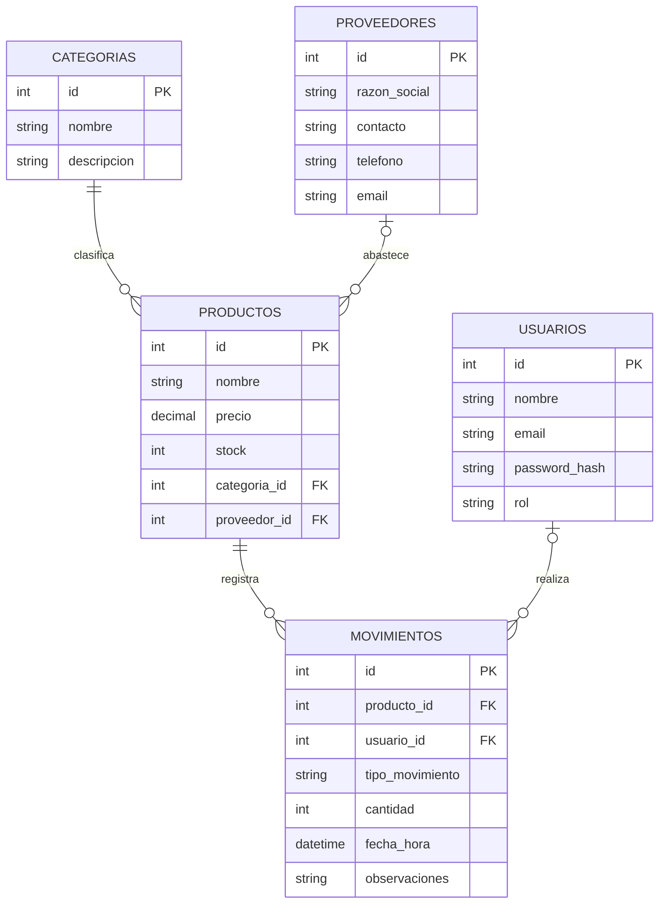

# API del panel de inventario

API REST con Express, Sequelize y MySQL para el panel `appInventario`.

## Configuración

1. Crea una base de datos MySQL (por defecto, `bdinventario`).
2. Copia `.env.example` a `.env` y configura `DB_HOST`, `DB_PORT`, `DB_NAME`, `DB_USER`,
   `DB_PASS` y `PORT`. Usa el puerto de MySQL indicado por HeidiSQL; el predeterminado
   de la aplicación es `3306`.
3. Instala y ejecuta:

   ```powershell
   npm.cmd install
   npm.cmd run dev
   ```

Al arrancar, Sequelize sincroniza el esquema existente y crea las tablas `Productos`,
`Categorias`, `Proveedores`, `Usuarios` y `Movimientos`, además de sus relaciones.

## Relaciones y endpoints

- Una categoría puede tener varios productos; cada producto nuevo debe tener categoría.
- Un proveedor puede tener varios productos; el proveedor de un producto es opcional.
- Los movimientos se relacionan con un producto y opcionalmente con un usuario.
- `POST /movimientos` recibe `productoId`, `tipoMovimiento` (`Entrada`, `Salida` o
  `Ajuste`), `cantidad` y el motivo obligatorio en `observaciones`. En ajustes, la cantidad puede ser
  positiva o negativa; en entradas y salidas debe ser positiva. El stock nunca puede
  quedar por debajo de cero.
- `GET /dashboard/resumen` entrega indicadores, productos con stock menor o igual a 5
  y los movimientos recientes.
- El stock inicial incluido al crear un producto se guarda como una entrada `Saldo inicial`.
  Las actualizaciones de producto no pueden cambiar el stock directamente.

La inserción del Kardex y la actualización de existencias se ejecutan en una única
transacción de Sequelize.

## Diagrama entidad-relación


