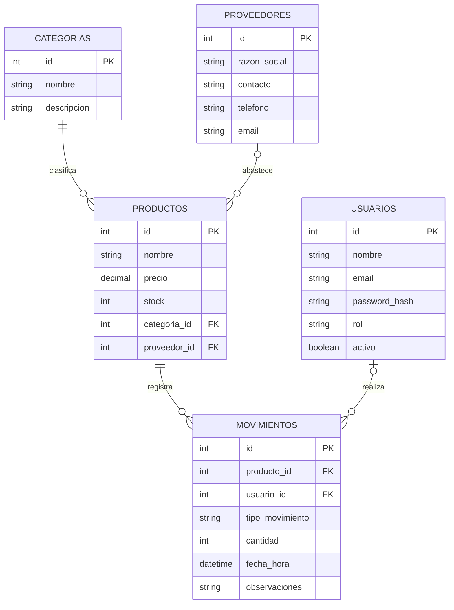

# API del panel de inventario

API REST con Express, Sequelize y MySQL para el panel `appInventario`.

## Configuración

1. Crea una base de datos MySQL (por defecto, `bdinventario`).
2. Copia `.env.example` a `.env` y configura `DB_HOST`, `DB_PORT`, `DB_NAME`, `DB_USER`,
   `DB_PASS`, `PORT` y un `JWT_SECRET` aleatorio de al menos 32 bytes. `JWT_EXPIRES_IN`
   define la duración de la sesión (por defecto, `2h`) y `FRONTEND_ORIGINS` limita los
   orígenes permitidos por CORS. Usa el puerto de MySQL indicado por HeidiSQL; el
   predeterminado de la aplicación es `3306`. No compartas ni subas `.env`.
   Puedes generar el secreto desde PowerShell con:

   ```powershell
   node -e "console.log(require('node:crypto').randomBytes(48).toString('hex'))"
   ```
3. Instala y ejecuta:

   ```powershell
   npm.cmd install
   npm.cmd run dev
   ```

Al arrancar, Sequelize sincroniza el esquema existente y crea las tablas `Productos`,
`Categorias`, `Proveedores`, `Usuarios` y `Movimientos`, además de sus relaciones.

## Relaciones y endpoints

- Una categoría puede tener varios productos; cada producto nuevo debe tener categoría.
- Un proveedor puede tener varios productos; el proveedor de un producto es opcional.
- Los movimientos se relacionan con un producto y opcionalmente con un usuario.
- `POST /api/auth/register` registra una cuenta; la primera recibe el rol Administrador y los
  registros públicos posteriores reciben Almacenero. El rol no se acepta desde el formulario.
  Las contraseñas nuevas deben tener al menos 8 caracteres y un máximo de 72 bytes.
- `POST /api/auth/login` valida las credenciales y devuelve un JWT; `GET /api/auth/me` valida el
  token y entrega la identidad autenticada. Las rutas de inventario requieren
  `Authorization: Bearer <token>`.
- `/usuarios` permite listar, crear, editar y eliminar cuentas solo a administradores; nunca
  devuelve hashes. Las categorías y proveedores son de lectura para almaceneros y editables por
  administradores. Productos, Kardex y Dashboard requieren sesión. Un usuario desactivado deja de
  poder usar inmediatamente sus tokens.
- Las contraseñas nuevas usan bcrypt; las cuentas existentes con scrypt pueden iniciar sesión y
  su hash se migra a bcrypt tras una autenticación correcta. Se limitan los intentos de registro
  y login, se aplican cabeceras Helmet y CORS restringido.
- `POST /movimientos` recibe `productoId`, `tipoMovimiento` (`Entrada`, `Salida` o
  `Ajuste`), `cantidad` y el motivo obligatorio en `observaciones`. En ajustes, la cantidad puede ser
  positiva o negativa; en entradas y salidas debe ser positiva. El stock nunca puede
  quedar por debajo de cero.
- `GET /dashboard/resumen` entrega indicadores, productos con stock menor o igual a 5
  y los movimientos recientes.
- El stock inicial incluido al crear un producto se guarda como una entrada `Saldo inicial`.
  Las actualizaciones de producto no pueden cambiar el stock directamente.

La inserción del Kardex y la actualización de existencias se ejecutan en una única
transacción de Sequelize.

## Diagrama entidad-relación


